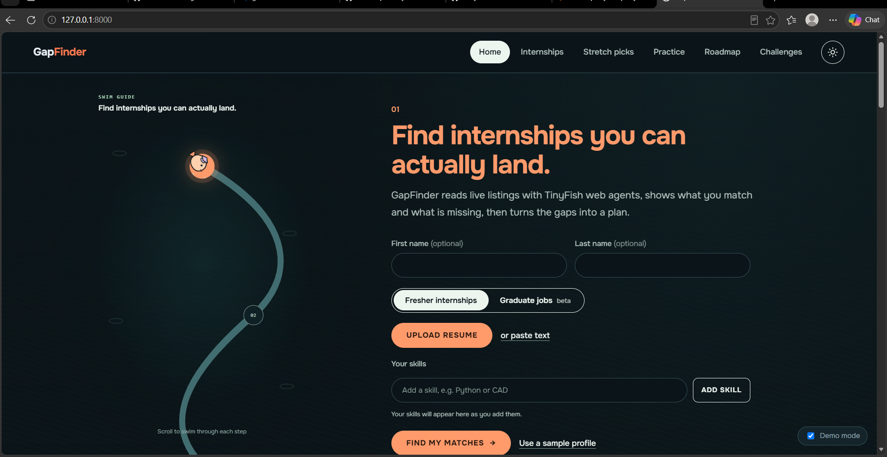

# GapFinder

Close the gap between you and the opportunity.

GapFinder helps students and freshers find internships that match their skills, see which skills they are missing, and get a plan to fix them. Built with TinyFish.

## The problem
Students can't tell which internships fit them. Requirements are scattered across platforms, skill gaps are unclear, and generic resumes don't highlight relevant experience.

## Features
- **Smart opportunity matching:** find jobs from your resume or entered skills
- **Resume match analysis:** skill-by-skill match for each role
- **Skill development:** practice tasks for the skills you lack
- **Resume tailoring:** a role-specific resume
- **Company challenges:** attempt coding challenges and showcase solutions
- **Skill roadmap:** a weekly plan (Plan, Learn, Practice, Celebrate)

## How it works
Internship listings have no public API, so GapFinder uses the TinyFish Agent API. We give it a plain-language goal and a listings page, and it returns structured JSON for each listing (title, company, stipend, deadline, required skills). Data comes from live pages, so listings stay current.

## Setup
1. Clone the repo
2. Install dependencies: `pip install -r requirements.txt`
3. Create a `.env` file: `TINYFISH_API_KEY=your_key_here`
4. Run: python -m uvicorn main:app --reload, then open http://127.0.0.1:8000
## Future scope
More job sources, personalised roadmaps with progress tracking, verified coding assessments, employer dashboards, and better matching through feedback.
